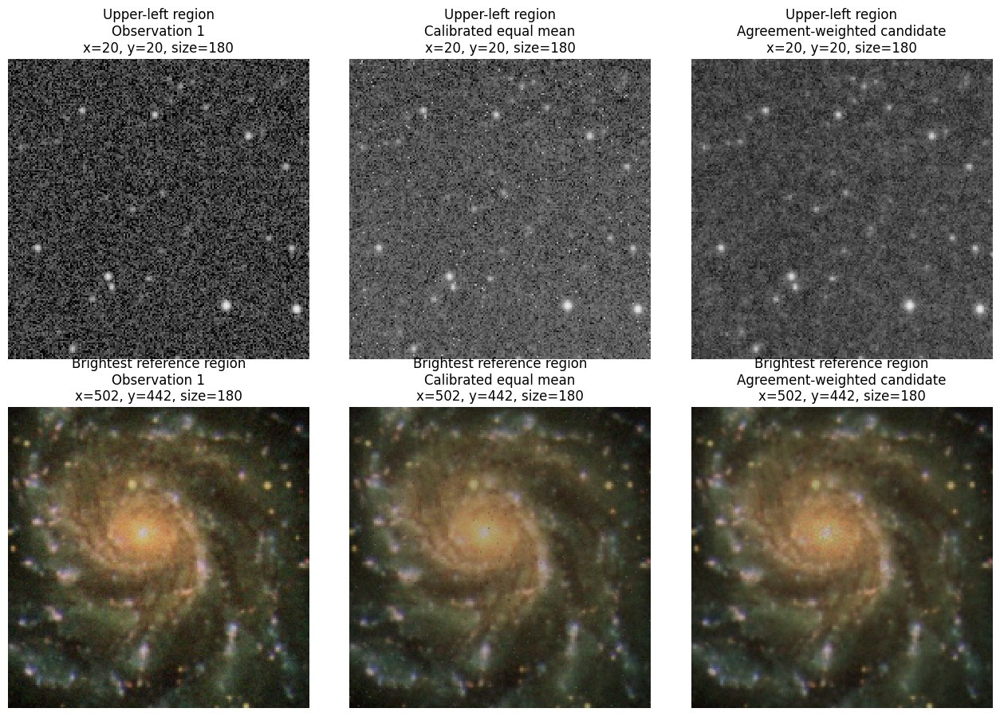
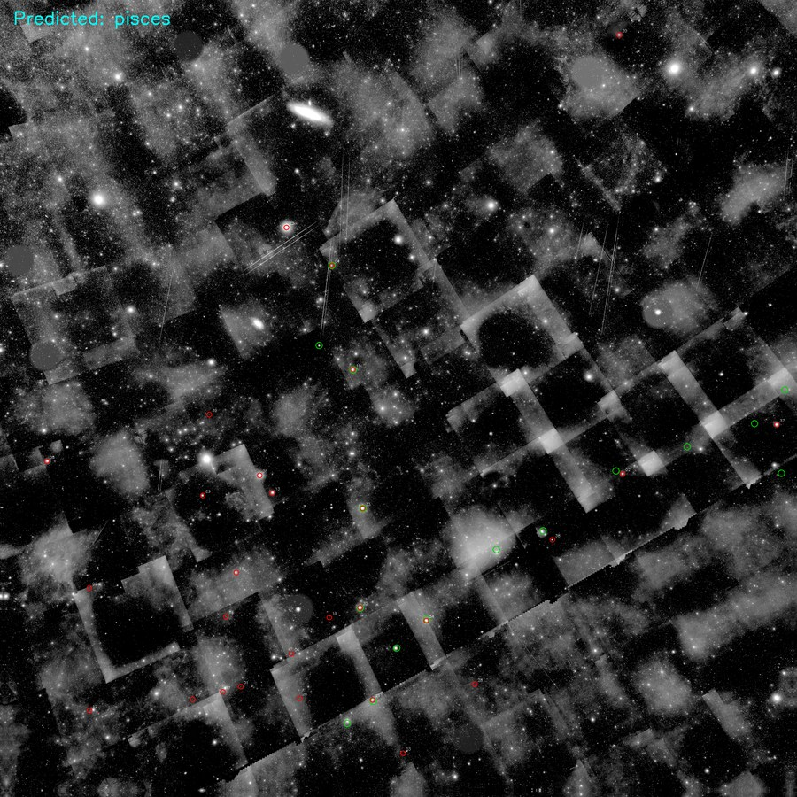

# Image restoration and constellation detection

**My contribution.** I implemented the notebook and the Kaggle solution selected for our team's submission. Ta-Chun Tai and I submitted the project together.

[Experiments, comparisons and technical decisions](EXPERIMENTS.md)

## IPython notebook · Q1–Q4 · Recovering structure from degraded images

The notebook compares histogram-matching rules for color recovery, aligns and intensity-calibrates five observations of a galaxy, implements smoothing, Sobel gradients and edge selection in NumPy, and searches a panorama for templates across its horizontal seam. In the galaxy reconstruction, a pixel receives more weight when its calibrated observations agree. Shared blur or bias can survive that test. Without a clean reference image, the visual comparison is more informative than an estimated PSNR.



[Open the notebook](notebooks/vision.ipynb) · [View the full reconstruction](assets/restoration.jpg)

## Kaggle · Q5 · Finding a constellation in a cluttered sky

The pipeline searches over rotation and scale with normalized cross-correlation, combines the peaks with polar-search candidates, then uses a learned verifier and geometric agreement with star patterns to select locations and infer the constellation name. The final CSV describes 16 scenes. Three labeled training scenes limit the evidence for generalization.



**Team public score · 0.86206.** The scene metric weights patch presence (25%), localization (20%), geometric node recovery (25%) and exact constellation name (30%).

## Reproduction

Open the notebook with the working directory set to `notebooks/`. Arrange the supplied files under `data/q1` through `data/q4`. Its setup cell lists the expected filenames and the dependency instructions precede it.

For the competition, work from `competition/` with Python 3.10+. Restore the original course `participant/` directory there, including patterns, sample submission, training labels, and the training and validation images. The code includes fitted verifier parameters and the image-derived polar candidates used in the submitted run.

```sh
python3 -m pip install -r requirements.txt
python3 -m unittest discover -s tests -v
python3 validate_submission.py outputs/submission.csv
```

For a full replay in a fresh working copy, run `bash reproduce_final.sh`. It fits the verifier, performs the image search, applies geometric selection and writes the CSV. Local portfolio checks passed all nine tests and validated the archived CSV's 16 rows and 90 columns. The full image search was outside that check.

[Replay script](competition/reproduce_final.sh) · [Submitted predictions](competition/outputs/submission.csv)
