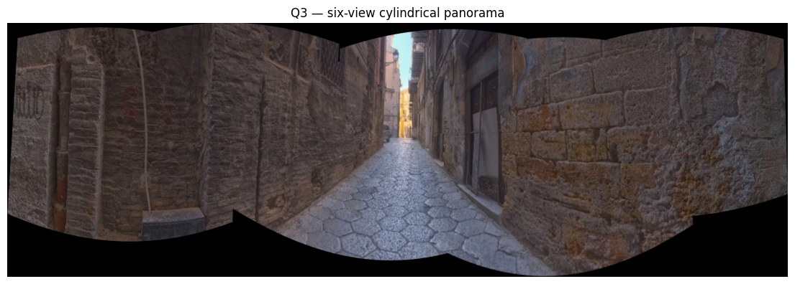
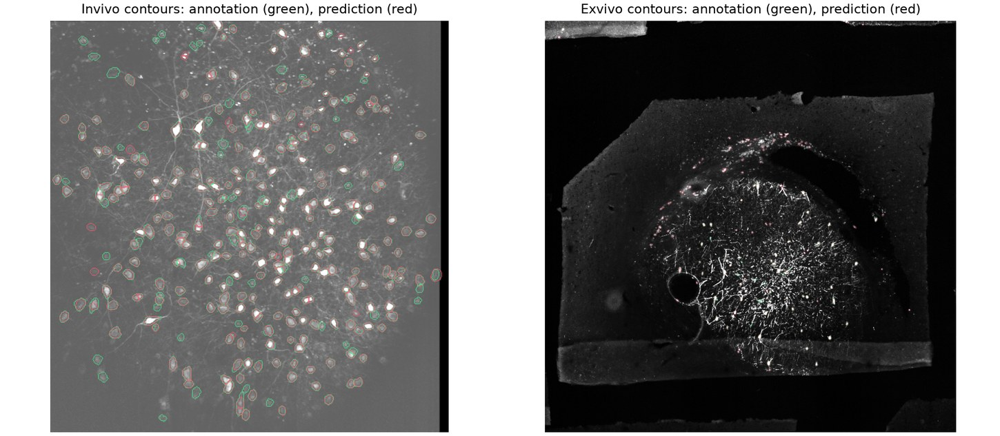

# Image geometry and cell matching

**My contribution.** I implemented the submitted Kaggle pipeline. Our team selected Ta-Chun Tai's notebook. My notebook experiments also used SIFT matching and a RANSAC homography for cover replacement. For click-guided segmentation I explored SAM, while the submitted notebook uses GrabCut.

## IPython notebook · Q1–Q4 · Geometry notebook

The team notebook detects runway boundaries, replaces a book cover with a homography, stitches six views into a panorama, and segments foreground objects from user clicks. Run it from `notebooks/` with the course folders `data/Q1` through `data/Q4` and OpenCV, NumPy, matplotlib and IPython installed.



[Open the notebook](notebooks/vision.ipynb)

## Kaggle · Q5 · Matching cells between two microscopy views

In vivo and ex vivo microscopy capture the same tissue under different imaging conditions. A correct correspondence requires locating the cell in each view, segmenting both endpoints and pairing their instance IDs. Bright fibers in the ex vivo view can resemble cell boundaries.

The pipeline estimates native masks with modality-specific networks, reconciles affine registration proposals, and refines in vivo contours using CPDINO candidates. Two learned heads score candidate pairs. Their mean score and a one-to-one selection rule determine the final correspondence list.



Green shows annotated boundaries and red shows held-mouse predictions for one development region. This diagnostic uses Stage652, the validation counterpart of the submitted Stage653 configuration.

**Team public score · 0.42847.** The metric weights in vivo panoptic quality (25%), ex vivo panoptic quality (25%) and pair F1 (50%). The submitted configuration produced 8,360 in vivo instances, 2,796 ex vivo instances and 386 pairs across 29 regions. These are prediction counts.

## Run the frozen model

Use Python 3.12 from `competition/`. Copy the complete `weights/` directory from the final NoCPT Stage653 submission package into this directory. The portfolio includes its checksum manifest. The two public initializers and 26 fitted checkpoints are external. Each input region uses the layout `images/SUBJECT/REGION/{invivo,exvivo}.tif`.

```sh
python -m pip install -r requirements.txt
python run_stage653.py --images /path/to/images --output /path/to/new-output
```

The program verifies each checkpoint and writes `submission.csv` and a verification record. Use a fresh output directory when changing the inputs. The submitted 29-region audit was performed on Apple MPS. Device and library versions can affect numerical parity.

[Prediction entry point](competition/run_stage653.py) · [Checkpoint manifest](competition/weights/manifest.json) · [Archived parity audit](competition/evidence/raw_inference/full29_parity_audit.json)

To compare your complete run with the submitted file, run the following from the same directory.

```sh
python verify_submission.py /path/to/new-output/submission.csv evidence/reference_submission_stage653.csv
```

**Local portfolio check.** CPU inference on the archived blank TIFF pair verified all 28 checkpoints and produced zero instances and zero pairs. The output CSV matched the original blank-input checksum. The 29-region counts above come from the submitted audit.
