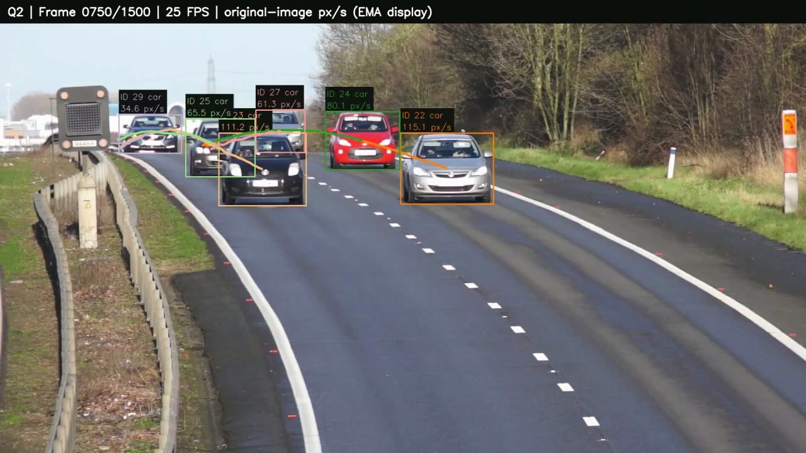

# Motion tracking and penalty-kick prediction

**My contribution.** I implemented the submitted notebook. My competition experiments explored body pose, goalkeeper tracking and temporal SAM 3D Body features. Ta-Chun Tai implemented the competition version our team submitted. The kick-direction ensemble below describes that final team version.

## IPython notebook · Q1–Q3 · Interpreting a CNN and measuring motion

The notebook compares intermediate ResNet50 and DenseNet121 features and uses Grad-CAM to locate evidence for the predicted class. For the highway sequence, instance masks restrict optical flow to vehicle pixels. Across 1,501 frames at 25 FPS, the tracker produced 44 IDs and 8,268 vehicle observations. Median apparent speed was 90.76 pixels/s. Converting this to road speed would require camera calibration.



The person-and-dog tracker distinguishes detections from predicted positions during occlusion. At frames 330 and 340 the dog's box is predicted. A visible dog detection returns at frame 360. This distinction matters when estimating how much of a trajectory is supported by image evidence.

[Open the notebook](notebooks/vision.ipynb) · [Tiger Grad-CAM](assets/gradcam.jpg) · [Occlusion sequence](assets/occlusion.jpg)

To rerun the notebook, start in `notebooks/` with the four supplied files in `data/`: `Royal-Bengal-Tiger.jpg`, `face.png`, `highway.mp4` and `video.mp4`. Use a Colab GPU runtime or equivalent PyTorch environment with access to the pretrained models. The notebook checks input sizes and writes figures, video and per-frame measurements to `output/`.

## Kaggle · Q4 · Predicting the shot and the goalkeeper's response

The team predicts two directions from observations before ball contact. The kick branch combines pose geometry, an RGB crop of the kicker and a short sequence of SAM body tokens. The goalkeeper branch uses recent pose and motion, with a separate fallback for weak tracks.

**Team public score · 0.81777.** The competition weights kick direction accuracy at 70% and goalkeeper direction accuracy at 30%. The replay checks the predictions against the submission. The public leaderboard supplies the score.

## Replay the submission

From `competition/` in a Python 3.11+ environment, run:

```sh
python -m pip install -r requirements.txt
python program/run.py --verify
```

The included model weights and numeric feature caches support CPU inference without the videos. Local verification executed 30 model components and reproduced all 900 rows byte for byte. The verifier also checked per-clip probabilities against the archived reference. Fresh video feature extraction and GPU retraining require the complete original package, dataset and upstream models.

[Inference code](competition/program/run.py) · [Submitted predictions](competition/output/submission.csv) · [Score receipt](competition/output/score_receipt.json)
