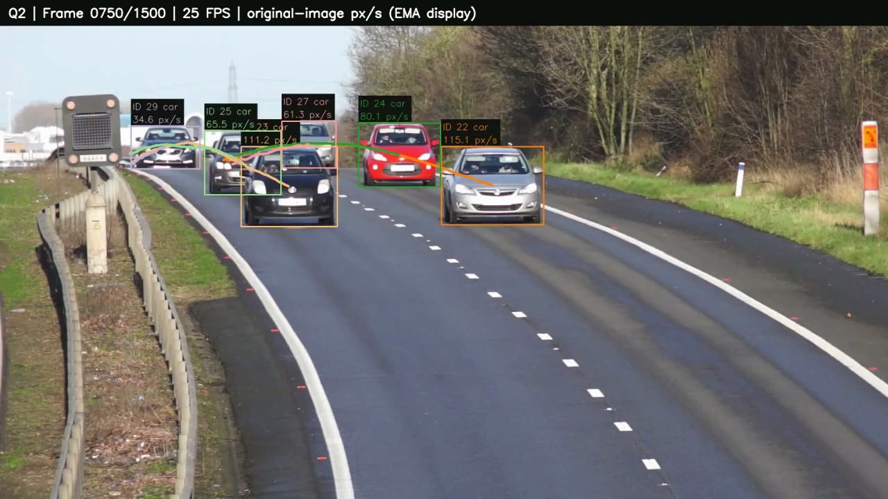

# Computer Vision Portfolio

Jim Lo · CS-GY 6643 Computer Vision

Each project opens with a set of vision problems documented in an IPython notebook. The final question is a separate Kaggle task. The table identifies whose implementation the team submitted for each part.

| Project | IPython notebook | Final question · Kaggle |
| --- | --- | --- |
| [Project 1](01-restoration-and-constellations/README.md) | [Q1 histogram matching, Q2 multi-image restoration, Q3 edge detection, Q4 template localization](01-restoration-and-constellations/notebooks/vision.ipynb). Submitted version by Jim Lo. | [Q5 · Constellation detection](01-restoration-and-constellations/competition). Submitted version by Jim Lo. Team public score **0.86206**. |
| [Project 2](02-geometry-and-cell-matching/README.md) | [Q1 runway boundaries, Q2 book cover replacement, Q3 panorama stitching, Q4 click-guided segmentation](02-geometry-and-cell-matching/notebooks/vision.ipynb). Submitted version by Ta-Chun Tai. | [Q5 · Cell segmentation and matching](02-geometry-and-cell-matching/competition). Submitted version by Jim Lo. Team public score **0.42847**. |
| [Project 3](03-tracking-and-penalty-kicks/README.md) | [Q1 CNN features and Grad-CAM, Q2 vehicle tracking and speed, Q3 person and dog tracking](03-tracking-and-penalty-kicks/notebooks/vision.ipynb). Submitted version by Jim Lo. | [Q4 · Penalty-kick prediction](03-tracking-and-penalty-kicks/competition). Submitted version by Ta-Chun Tai. Team public score **0.81777**. |

Each project also includes a short account of the experiments and technical decisions behind its final result.

- [Project 1 · experiments and decisions](01-restoration-and-constellations/EXPERIMENTS.md)
- [Project 2 · experiments and decisions](02-geometry-and-cell-matching/EXPERIMENTS.md)
- [Project 3 · experiments and decisions](03-tracking-and-penalty-kicks/EXPERIMENTS.md)

| Constellation search | Microscopy contours | Vehicle tracking |
| --- | --- | --- |
|  |  |  |

**Runnable example.** The penalty-kick project includes the trained inference models and derived features needed to regenerate the team's 900-row submission on CPU. [Run the replay](03-tracking-and-penalty-kicks/README.md#replay-the-submission)

Each score uses the metric defined for that competition. The notebooks retain the team's method discussions and AI-assistance disclosures. Course datasets are supplied separately.

Jim Lo and Ta-Chun Tai collaborated on these assignments under the Kaggle team name NoCPT.
