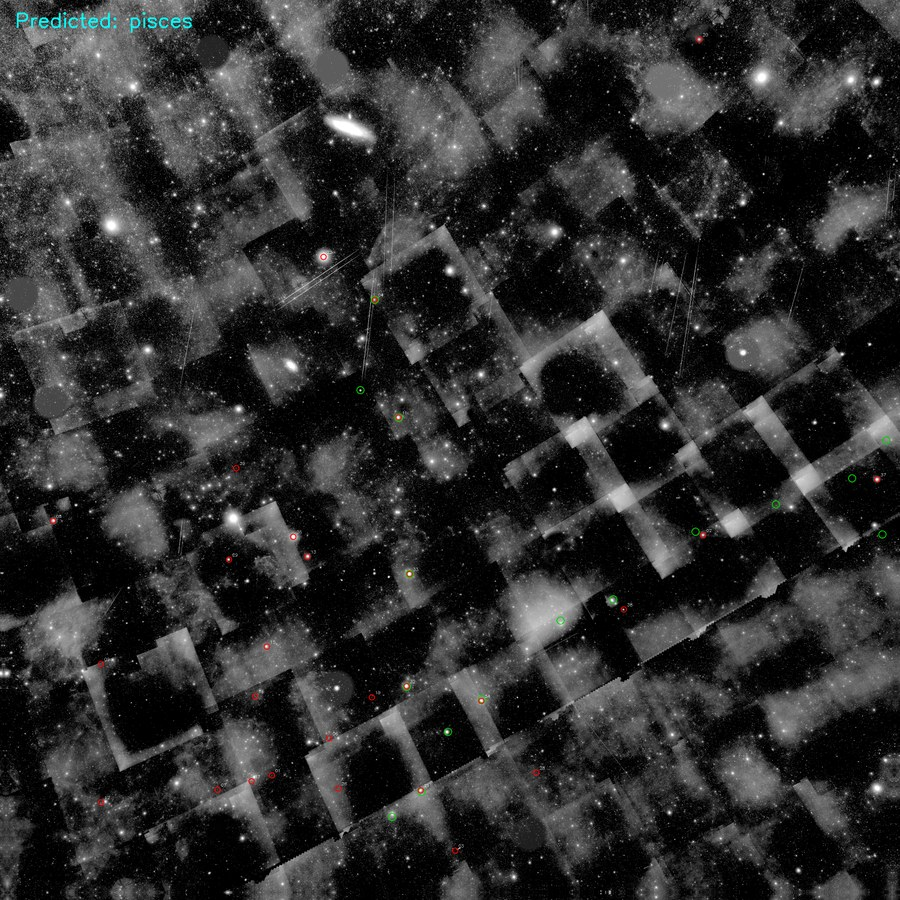
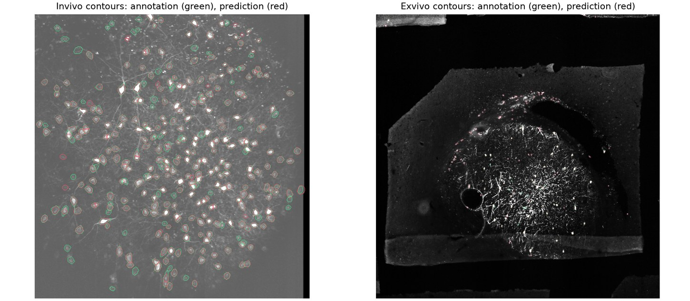

# Computer Vision Portfolio

**Jim Lo · CS-GY 6643 · Team NoCPT with Ta-Chun Tai**

Three computer vision projects covering image restoration, correspondence across imaging modalities, and motion analysis in video. The links below open the implementation, selected figures and reproduction instructions for each project.

| Project | My contribution | Team Kaggle public score |
| --- | --- | ---: |
| [Image restoration and constellation detection](01-restoration-and-constellations/README.md) | Implemented the submitted notebook and the constellation detection pipeline. | 0.86206 |
| [Image geometry and cell matching](02-geometry-and-cell-matching/README.md) | Implemented the submitted competition pipeline that segments cells and matches them across microscopy views. | 0.42847 |
| [Motion tracking and penalty kicks](03-tracking-and-penalty-kicks/README.md) | Implemented the submitted tracking and CNN interpretation notebook. Explored pose and motion features for the team competition. | 0.81777 |

| Constellation search | Microscopy contours | Vehicle tracking |
| --- | --- | --- |
|  |  |  |

**Runnable example.** The penalty-kick project includes the trained inference models and derived features needed to regenerate the team's 900-row submission on CPU. [Run the replay](03-tracking-and-penalty-kicks/README.md#replay-the-submission)

Each score uses the metric defined for that competition. The notebooks retain the team's method discussions and AI-assistance disclosures. Course datasets are supplied separately.
